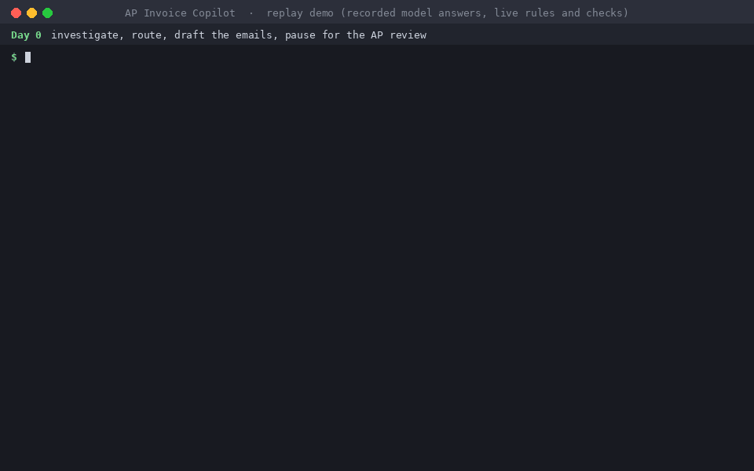
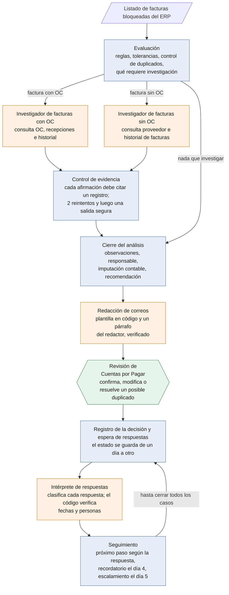

# AP Invoice Copilot

**Agentes de IA que gestionan las facturas bloqueadas de Cuentas por Pagar, con los controles que exigiría un equipo de finanzas.**

[Read in English »](README.md)

Cuando el ERP bloquea una factura para el pago (un precio que no coincide con la orden de compra, una cantidad sin recepción, un posible duplicado, una factura que requiere aprobación), alguien de Cuentas por Pagar tiene que analizarla, escribirle a la persona que corresponde y hacer el seguimiento hasta obtener respuesta. Este proyecto resuelve ese proceso de punta a punta: identifica cada observación de cada factura bloqueada, determina quién debe actuar, redacta el correo, interpreta las respuestas y hace el seguimiento hasta que la factura queda resuelta.

El principio de diseño: **la IA investiga y redacta. El código toma todas las decisiones financieras. Una persona aprueba.**



*La demo reproduce las respuestas registradas de los modelos, por lo que corre en segundos y no requiere instalar ningún modelo. Todas las reglas, controles y correos se calculan en el momento.*

> El sistema, los datos de prueba y los correos están en inglés porque replican el proceso de Cuentas por Pagar de una empresa estadounidense. Por eso los comandos, los nombres de archivo y los ejemplos se mantienen en inglés.

## En resumen

| | |
|---|---|
| **Alcance** | Facturas con orden de compra (diferencias de precio y de cantidad, orden de compra faltante o inválida, duplicados, datos incorrectos en la factura) y facturas sin orden de compra (servicios públicos, alquileres, impuestos, suscripciones, servicios profesionales): reglas de aprobación, imputación contable y control de categoría |
| **Controles sobre la IA** | Toda afirmación de un agente debe citar un registro que haya consultado. Cada párrafo de cada correo se verifica contra los datos. Las reglas, la asignación de responsables, la imputación contable y los plazos están en código. Toda factura queda en espera hasta que la revisa el analista de Cuentas por Pagar, y cada decisión queda registrada. |
| **Metodología de prueba** | Con criterio de auditoría: para dos lotes de casos nuevos, las respuestas esperadas se definieron a ciegas y se registraron en git *antes* de ejecutar cualquier modelo. Los resultados se informan tal como salieron, errores incluidos. |
| **Resultados en casos nuevos** | Motor de reglas: 58 de 58 facturas · investigador de facturas con OC: 25 de 26 · interpretación de respuestas: 33 de 36 · correos correctos: 81 de 82 · investigador de facturas sin OC: 28 de 32 conclusiones correctas, pero por debajo del mínimo en una de las columnas evaluadas ([detalle](#resultados)) |
| **Tecnología** | Python 3.13 · LangGraph (grafo con estado, pausa para revisión humana, checkpoints en SQLite) · Ollama con modelos locales (qwen3:14b, llama3.1:8b) · Pydantic · pytest (92 pruebas) |
| **Cómo probarlo** | [Cuatro comandos](#puesta-en-marcha), sin instalar ningún modelo. O, directamente, leer [todos los correos redactados](output/phase10/emails_llama3.1-8b.md) y el [informe de evaluación completo](docs/eval_report.md) (ambos en inglés). |

## Qué produce

Uno de los 23 correos de la demo, tal como lo redactó el sistema (aquí se cortaron las líneas largas). Una factura de agua llegó un 21,78% por encima del promedio de los últimos 12 meses del proveedor, por lo que el código la envió a aprobación del responsable del centro de costos y le asignó la cuenta contable. El primer párrafo y la explicación que comienza con "From our review" los escribieron agentes de IA y los verificó el código; el resto es una plantilla que completa el código.

```text
To: Kevin Doyle <kevin.doyle@northgate.example>
Subject: Approval needed: invoice CWA-77324 from Clearwater Water Authority

Hello Kevin,

You are required to review invoice CWA-77324 from Clearwater Water Authority, which has a total
of 1046.30. The bill differs from the vendor's average bill by more than 10%, and approval is
needed.

Invoice CWA-77324 from Clearwater Water Authority, dated 2026-11-28, amount 1046.30.
Service month: 2026-11
Cost center: Facilities (CC-200)
GL account: 6100
Lines:
- line 1: Water and sewer service November 2026: amount 1046.30
Issues:
1. Approval needed
   - bill 15: average of the last 12 bills is 859.19; 1046.30 is +21.78%, over 10%
   - approver P-109: owner of CC-200
   - GL 6100 from category utilities
   From our review: This bill (1046.30) is 21.78% higher than the average of the last 12
   bills (859.19), exceeding the 10% threshold. Previous bills ranged from 827.95 to 889.35
   (e.g., CWA-77310: 862.40, CWA-77323: 843.60).
Action requested:
- Approve or reject this invoice.
Reply by: 2026-12-03

Accounts Payable
Northgate Distribution
ap@northgate.example
```

Si Kevin no responde, el día 4 recibe un recordatorio con copia a su superior directo, y el día 5 el pedido se escala a ese superior.

## Cómo funciona



Azul: código. Naranja: agentes de IA. Verde: la persona.

**El código decide todo lo que mueve dinero:** controles, tolerancias, reglas de duplicados, asignación de responsables, imputación contable, aprobaciones, plazos, recordatorios y escalamientos. **Cuatro agentes se encargan de lo que requiere interpretación**, y el código verifica a cada uno:

| Agente | Función | Qué verifica el código |
|---|---|---|
| Investigador de facturas con OC (PO investigator) | Explica las diferencias de precio y de cantidad, evalúa si un posible duplicado factura el mismo cargo y busca la OC abierta a la que corresponde una factura | Que cada afirmación cite un registro devuelto por una consulta en esa misma ejecución y que cada cifra figure en los datos que se le mostraron. Tiene dos reintentos; si no, una salida segura deriva el caso a Cuentas por Pagar. |
| Investigador de facturas sin OC (non-PO investigator) | Explica variaciones en el importe de las facturas y diferencias de alquiler con el contrato, verifica que cada línea corresponda a la categoría del proveedor y sugiere una categoría para un proveedor que no la tiene | El mismo control de evidencia. Si no logra demostrar que una línea corresponde, se considera que no corresponde y la revisa Cuentas por Pagar. |
| Intérprete de respuestas (reply interpreter) | Lee cada respuesta en texto libre y la clasifica: aprobada, rechazada, corrección en camino, consulta, derivada a otra persona o no concluyente | Una fecha comprometida debe figurar textualmente en la respuesta, y una persona mencionada debe estar registrada. De lo contrario, la respuesta se considera no concluyente y pasa a Cuentas por Pagar. |
| Redactor (communicator) | Escribe un párrafo en lenguaje claro para cada correo | Recibe solo los datos que necesita ese párrafo. Una verificación rechaza cualquier cifra, código o nombre que no esté entre ellos, y una frase fija reemplaza el párrafo rechazado. |

**Reglas de Cuentas por Pagar que aplica**

| Tipo de factura | Regla | Responsable |
|---|---|---|
| Con orden de compra | Diferencia de precio o de cantidad superior al 2% o a US$ 100, lo que sea menor | Comprador |
| | OC inexistente, cerrada o de otro proveedor; datos de la factura faltantes o inconsistentes | Proveedor (el agente sugiere la OC abierta que corresponde) |
| | Duplicado exacto: queda bloqueada. Posible duplicado (misma OC, o mismo número de factura una vez normalizado): los demás correos quedan en espera hasta que Cuentas por Pagar resuelva | Cuentas por Pagar y luego el proveedor |
| Sin orden de compra | Servicios públicos: aprobación si la factura se aparta más de un 10% del promedio de 12 meses, y en las 3 primeras facturas de un proveedor nuevo | Responsable del centro de costos |
| | Alquileres: cualquier diferencia con el contrato. Impuestos y suscripciones: siempre | Responsable del centro de costos |
| | Servicios profesionales: el solicitante confirma que el servicio se prestó y luego se aprueba (si el solicitante es el responsable del centro de costos, aprueba su superior) | Solicitante y luego responsable del centro de costos |
| | Proveedor sin categoría, factura sin solicitante o una línea que no corresponde a la categoría del proveedor | Bandeja de excepciones de Cuentas por Pagar |

**El seguimiento** se rige por días hábiles: el plazo de respuesta es de 3 días, el día 4 se envía un recordatorio con copia al superior y el día 5 el caso se escala al superior, que pasa a ser el responsable de la acción. **La imputación contable** la determina el código según la categoría del proveedor; ningún agente elige una cuenta. **Cada decisión**, modificación e interpretación de respuesta queda en un registro de decisiones.

Los datos corresponden a un distribuidor mayorista ficticio (proveedores, personas, centros de costos, órdenes de compra, recepciones e historial contabilizado) y a una planilla de excepciones con el formato de una exportación de ERP. No se envía ningún correo real ni se realiza ningún pago.

## Resultados

Hay tres conjuntos de casos, cada uno evaluado contra respuestas esperadas definidas de antemano. El mínimo exigido es 80% en cada columna evaluada con 5 casos o más.

- **Los 22 casos de desarrollo.** El código y las instrucciones de los modelos se ajustaron sobre ellos, por lo que sirven como prueba de regresión, no de generalización.
- **Lote A** (29 facturas, 18 respuestas): las respuestas esperadas las definió a ciegas un segundo agente de IA, las revisó el autor y se registraron en git antes de que ningún modelo viera los casos.
- **Lote B** (29 facturas, 18 respuestas): las respuestas esperadas las definió a ciegas el autor, se registraron antes de cualquier ejecución y el lote se ejecutó una sola vez, como prueba de confirmación del código en su versión final, sin cambios antes ni después.

| Función del agente | 22 casos (ajustados) | Lote A | Lote B |
|---|---|---|---|
| Investigador de facturas con OC | 9 de 9 casos | 12 de 13 ✅ | **13 de 13** ✅ |
| Investigador de facturas sin OC | 9 de 12 casos | 9 de 16 ❌ | **8 de 16** ❌ |
| Intérprete de respuestas | 18 de 18 respuestas | 16 de 18 ✅ | **17 de 18** ✅ |
| Redactor, primeros correos | 23 de 23 correctos | 28 de 28 ✅ | **28 de 28** ✅ |
| Redactor, recordatorios y escalamientos | 7 de 7 | 12 de 13 ✅ | **13 de 13** ✅ |
| Motor de reglas (solo código) | 22 de 22 facturas | 29 de 29 | **29 de 29** |

✅ cumple el mínimo · ❌ no cumple el mínimo

**Limitaciones principales:**
- **El investigador de facturas sin OC no alcanza el mínimo en una columna: la primera consulta que realiza** (5 de 10 en el lote A, 4 de 10 en el B). Sus conclusiones fueron correctas en 14 de 16 casos de cada lote; esa columna evalúa el orden de las consultas.
- **Sus dos errores reales por lote son líneas que no corresponden a la categoría del proveedor**, como el alquiler de un generador en una factura de energía eléctrica. Cuando no detecta el desvío, la factura llega a Cuentas por Pagar con recomendación de liberarla y sin ninguna alerta, por lo que la revisión del analista es el último control.
- **El intérprete de respuestas se excede con las aprobaciones parciales** ("paguen el alquiler, los muebles no"): las clasifica como rechazadas cuando deberían quedar como no concluyentes.

Las correcciones de cada punto figuran en [Mejoras pendientes](#mejoras-pendientes). No se aplicaron a propósito: el lote B era el último conjunto de casos nuevos, y una corrección ajustada sobre los mismos casos que revelaron el problema dejaría de ser un resultado honesto.

El informe completo, con cada caso, cada intento, los tiempos de ejecución y las evaluaciones manuales, está en [`docs/eval_report.md`](docs/eval_report.md). La forma en que se armaron, definieron y sellaron los lotes está en [`evals/README.md`](evals/README.md) (ambos en inglés).

<details>
<summary><b>Resultados por modelo y por qué se usan dos</b></summary>

El modelo de cada agente se eligió a partir de las ejecuciones sobre los 22 casos:

| Función del agente | llama3.1:8b | qwen3:14b |
|---|---|---|
| Investigador de facturas con OC | 8 de 9 (ajustado sobre este modelo) | 9 de 9 |
| Investigador de facturas sin OC | 8 de 12 | 9 de 12 |
| Intérprete de respuestas | 17 de 18 | 18 de 18 |

Una primera prueba de cuatro modelos locales sobre 20 casos (5 por función, con un mínimo de 4 de 5 en cada una) dio estos resultados: llama3.1:8b, 19 de 20; qwen3:4b, 19; qwen3:8b, 18; y qwen3:14b, 20. llama3.1:8b es rápido y redacta los correos; qwen3:14b se usa en los tres agentes donde pesa el criterio, con unos 20 minutos por caso con OC en el equipo de desarrollo. El modelo de cada agente es un parámetro de configuración, por lo que un servidor más rápido o un modelo más potente se incorpora sin cambiar el código.

</details>

## Puesta en marcha

**La demo reproduce las ejecuciones registradas de los modelos, por lo que solo requiere Python 3.13:** no hace falta Ollama ni descargar modelos. En Windows PowerShell:

```powershell
git clone https://github.com/augustosander24/ap-invoice-copilot.git
cd ap-invoice-copilot
py -3.13 -m venv .venv
.venv\Scripts\python.exe -m pip install -r requirements.txt
copy .env.example .env
```

Luego se ejecuta el ciclo completo:

| Paso | Comando | Resultado esperado |
|---|---|---|
| Día 0: investigación, asignación, redacción y pausa para revisión | `.venv\Scripts\python.exe scripts\run_emails.py` | `emails drafted: 23; paused for review: 22` |
| Revisión de Cuentas por Pagar (con decisiones predefinidas) | `.venv\Scripts\python.exe scripts\review.py --decisions data\input\review_decisions.csv --edits data\input\review_edits.csv` | `decision log: 22 entries` |
| Día 4: lectura de respuestas y envío de recordatorios | `.venv\Scripts\python.exe scripts\run_day.py --day 4` | `sent today: 4 reminders, 0 escalations, 2 approvals after their confirmations` |
| Día 5: escalamiento | `.venv\Scripts\python.exe scripts\run_day.py --day 5` | `sent today: 0 reminders, 3 escalations` |

Cada ejecución guarda sus correos en un archivo Markdown legible junto a su JSON (por ejemplo `output/phase10/emails_llama3.1-8b_replay.md`). Si se ejecuta `review.py` sin argumentos, cada factura se revisa manualmente en la terminal. Para empezar de cero, se borran `output\phase10\checkpoints.sqlite` y `output\phase10\decision_log.jsonl`.

En macOS o Linux: `python3.13 -m venv .venv`, `cp .env.example .env` y `.venv/bin/python` con barras normales.

<details>
<summary><b>Controles, pruebas, modelos en vivo y lotes de evaluación</b></summary>

**Controles y pruebas.** Cada uno muestra su resultado en la última línea:

```powershell
.venv\Scripts\python.exe scripts\check_rules.py         # 22 of 22 cases match
.venv\Scripts\python.exe -m pytest tests -q             # 92 passed
```

**Ejecutar los modelos en vivo.** Instalar [Ollama](https://ollama.com) y luego ejecutar `ollama pull qwen3:14b` y `ollama pull llama3.1:8b`. Cada script acepta una opción para ejecutar su agente en lugar de reproducir la ejecución registrada:

```powershell
.venv\Scripts\python.exe scripts\run_emails.py --investigator live --communicator live
.venv\Scripts\python.exe scripts\run_day.py --day 4 --interpreter live --communicator live
```

Los investigadores y el intérprete también pueden evaluarse por separado contra las respuestas esperadas: `scripts\run_po_agent.py`, `scripts\run_nonpo_agent.py` y `scripts\run_replies.py`.

**Ejecutar un lote de evaluación.** Agregar `--set heldout_a` o `--set heldout_b` a cualquier control o script, por ejemplo `.venv\Scripts\python.exe scripts\check_rules.py --set heldout_b`. `scripts\eval_report.py` regenera `docs/eval_report.md` a partir de las ejecuciones registradas.

</details>

<details>
<summary><b>Configuración: modelos, razonamiento y límites de salida</b></summary>

La configuración está en `.env` (copiado de `.env.example`, que contiene la configuración de referencia):

| Parámetro | Función | Valor de referencia |
|---|---|---|
| `OLLAMA_HOST` | Dirección del servidor de Ollama | `http://localhost:11434` |
| `MODEL` | Modelo para cualquier agente sin parámetro propio | `llama3.1:8b` |
| `MODEL_PO_INVESTIGATOR`, `MODEL_NONPO_INVESTIGATOR`, `MODEL_REPLY_INTERPRETER`, `MODEL_COMMUNICATOR` | Modelo de cada agente; si está vacío, se usa `MODEL` | `qwen3:14b` en los tres primeros; vacío en el redactor |
| `THINK_<AGENT>` | Razonamiento de cada agente: `on` u `off` envía a Ollama el parámetro think; vacío no envía nada y se aplica el valor predeterminado del modelo | `on` en los tres agentes con qwen3:14b; vacío en el redactor |
| `LANGGRAPH_STRICT_MSGPACK` | Hace que LangGraph rechace cualquier estado que no pueda guardar en un checkpoint | `true` |

Las ejecuciones registradas se identifican por el nombre del modelo, por lo que la demo solo las reproduce con los modelos de referencia. Un modelo sin modo de razonamiento, como llama3.1:8b, debe dejar `THINK` vacío: Ollama rechaza `think` en ese caso.

**Límites de salida.** Cada llamada a un modelo tiene un máximo de tokens a generar, incluido el razonamiento: 4.096 para los investigadores y el intérprete, y 512 para el redactor (`MAX_TOKENS` en `ap_copilot/config.py`). Una llamada que alcanza el límite sigue la ruta segura de su agente (un reintento y luego la salida segura, una respuesta no concluyente o la frase fija), y su `done_reason` queda registrado.

**Cambio de modelo.** Cualquier modelo disponible en Ollama se incorpora por configuración, sin cambiar el código: se define `MODEL_<AGENT>`, se ajusta `THINK_<AGENT>` según el modelo, se ejecuta ese agente en vivo y se evalúa con los mismos casos y lotes. Un modelo por API requiere antes una clase cliente junto a `OllamaClient` (`ap_copilot/investigator.py`) con el mismo método `chat()`.

</details>

## Decisiones de diseño y origen de las reglas

| Regla | Fundamento |
|---|---|
| Bloquear para el pago una factura cuyo precio o cantidad difiere de la OC más allá de una tolerancia; no puede pagarse hasta que se levante el bloqueo | Comportamiento estándar de los ERP: en SAP, la [verificación de facturas con diferencias](https://learning.sap.com/courses/invoice-verification-in-sap-s-4hana/entering-invoices-with-variances-1) bloquea la factura para el pago cuando se supera el límite de tolerancia; Oracle Payables aplica un bloqueo (hold) por conciliación cuando se superan las [tolerancias de factura](https://docs.oracle.com/en/cloud/saas/financials/25d/faipp/invoice-tolerances.html), por ejemplo cuando [la cantidad facturada supera la recibida o el precio supera el de la OC](https://docs.oracle.com/cd/A60725_05/html/comnls/us/ap/holdap03.htm) |
| Tolerancia de 2% o US$ 100, lo que sea menor, para precio y cantidad | **Decisión de diseño.** Ambos ERP permiten que cada empresa defina límites porcentuales y por importe; estos valores son habituales en empresas medianas |
| Control de duplicados por proveedor y número de factura, con el número normalizado (mayúsculas, signos de puntuación, espacios, ceros a la izquierda) | El [control de facturas duplicadas de SAP](https://help.sap.com/saphelp_afs64/helpdata/en/ce/4f3e39ea3aee02e10000000a114084/content.htm) compara el número de referencia y otros atributos; Oracle Payables impide registrar el mismo número para el mismo proveedor y advierte que [no detecta variantes, como un cambio de mayúsculas](https://docs.oracle.com/cd/A60725_05/html/comnls/us/ap/duplinv.htm). Normalizar el número y enviar a un agente los posibles duplicados con la misma OC son **decisiones de diseño** |
| Las facturas con OC no requieren aprobación (la OC es la aprobación); las facturas sin OC requieren aprobación según su categoría | Práctica habitual; las categorías y sus reglas son **decisiones de diseño** |
| Servicios públicos: 10% contra el promedio de 12 meses y las 3 primeras facturas de un proveedor nuevo; alquileres contra el contrato; impuestos, suscripciones y servicios siempre con aprobación; asignación de aprobadores; plazos de respuesta, recordatorio y escalamiento | **Decisiones de diseño de este proyecto**, no un estándar de ningún ERP |
| La entrada como listado de excepciones exportado | Inspirado en uno; no replica el formato de archivo de SAP, Oracle ni NetSuite |

<details>
<summary><b>Los 22 escenarios de prueba</b></summary>

| Caso | Escenario | Resultado esperado | Resultado |
|---|---|---|---|
| EX-001 | Diferencia de precio con la OC en una factura de menos de US$ 5.000 (aplica el límite del 2%) | diferencia de precio; bloqueo; consulta al comprador | correcto |
| EX-002 | Diferencia de precio en una factura de más de US$ 5.000 (aplica el tope de US$ 100); el comprador responde fuera de plazo | diferencia de precio; bloqueo; consulta al comprador | correcto |
| EX-003 | La factura cita una OC de otro proveedor; no hay una OC abierta que corresponda | OC inválida; corrección del proveedor | correcto |
| EX-004 | Recepción parcial; pequeña diferencia de precio dentro de la tolerancia | diferencia de cantidad; consulta al comprador | correcto |
| EX-005 | Sin recepción registrada y con diferencia de precio; el comprador deriva la consulta | diferencia de precio y de cantidad; consulta al comprador | correcto |
| EX-006 | La factura cita una OC cerrada | OC inválida; se sugiere al proveedor la OC abierta | correcto |
| EX-007 | Factura de un proveedor de mercadería sin número de OC | OC faltante; se sugiere la OC abierta | correcto |
| EX-008 | Factura reenviada sin los ceros a la izquierda | posible duplicado; resuelve Cuentas por Pagar | correcto |
| EX-009 | Diferencia de precio y un total de cabecera que no coincide con las líneas | diferencia de precio y datos faltantes | correcto |
| EX-010 | Duplicado exacto de una factura de servicios públicos ya contabilizada | duplicado exacto; bloqueada, se notifica al proveedor | correcto |
| EX-011 | Factura de servicios públicos dentro del 10% del promedio de 12 meses | sin observaciones; liberar | correcto |
| EX-012 | Factura de servicios públicos más de un 10% por encima del promedio; el aprobador nunca responde | aprobación; recordatorio y luego escalamiento | correcto (difiere la primera consulta) |
| EX-013 | Tercera factura de un proveedor nuevo de servicios públicos, sin período de servicio; el proveedor nunca responde | aprobación y datos faltantes | correcto (difiere la primera consulta) |
| EX-014 | Alquiler por encima del contrato (se agregó un recargo por mora) | aprobación | correcto |
| EX-015 | Alquiler igual al contrato | sin observaciones; liberar | correcto |
| EX-016 | Factura de contribución inmobiliaria | aprobación | correcto |
| EX-017 | Suscripción; el aprobador hace una consulta | aprobación; consulta a Cuentas por Pagar | correcto |
| EX-018 | El proveedor de la suscripción también factura hardware; respuesta no concluyente | aprobación y línea fuera de categoría | correcto |
| EX-019 | Factura de servicios en la que el solicitante es el responsable del centro de costos | confirmación; luego aprueba el superior | correcto |
| EX-020 | Factura de servicios: primero confirmación, luego aprobación | confirmación y luego aprobación | correcto |
| EX-021 | Factura de servicios sin solicitante | bandeja de excepciones de Cuentas por Pagar | correcto |
| EX-022 | Proveedor sin categoría | Cuentas por Pagar asigna la categoría; el agente sugiere una | correcto (difiere la primera consulta) |

"Difiere la primera consulta" significa que la respuesta del agente fue correcta, pero comenzó por una consulta distinta de la esperada. El resultado esperado completo de cada caso está en [`evals/expected_outcomes.csv`](evals/expected_outcomes.csv).

</details>

## Limitaciones

Las tres más relevantes están en [Resultados](#resultados). La lista completa:

<details>
<summary><b>Las 23 limitaciones</b></summary>

**Errores posibles de los agentes**
1. Una afirmación con su cita puede, igualmente, ser incorrecta. El control de evidencia comprueba que la afirmación remita a registros devueltos por las herramientas, no que el razonamiento sea correcto (las respuestas de llama3.1:8b en EX-018 y EX-013 lo superaron).
2. Una explicación puede afirmar una inferencia que el control no puede verificar (EX-008: "identical line items", inferido a partir de las líneas de la OC).
3. Una conclusión de que ninguna OC corresponde pasa el control si cita la búsqueda de OC abiertas, aunque exista una que corresponda (ocurrió dos veces durante el desarrollo).
4. Una línea fuera de categoría no detectada deja en el paquete de revisión de Cuentas por Pagar una recomendación de liberar sin ninguna alerta, y luego el código imputa la factura a la cuenta de la categoría del proveedor. Ocurrió en ambos lotes: EX-118 en el A; EX-218 (alquiler de un generador en una factura de energía eléctrica, liberada cuando el analista confirmó) y EX-221 (almacenamiento adicional en una suscripción) en el B.
5. El intérprete de respuestas se excede con respuestas parciales o ambiguas: una aprobación parcial debería ser no concluyente y el modelo la clasifica como rechazada (M-25 y M-32 en el A, M-62 en el B). En los 22 casos, M-16 está clasificada en contra de la regla de aprobación parcial que aplica M-32.
6. La clasificación de una respuesta es un juicio que el código no puede verificar: el control cubre solo una fecha comprometida y una persona mencionada. Además, el intérprete completa campos de fecha y de persona que no necesita; el código solo los lee en las clasificaciones que los usan.

**Lo que los controles no detectan**

7. La verificación de párrafos comprueba que las cifras y los nombres existan en los datos, no que la oración sea correcta. Un nombre desconocido como primera palabra de una oración no se detecta.
8. Una explicación genérica cumple igual la regla de las cinco palabras.
9. El control de evidencia puede rechazar tres veces una respuesta correcta cuyo identificador de evidencia figura solo en el texto de la explicación, y derivar luego el caso a revisión de Cuentas por Pagar (EX-112 en el A).
10. En cada lote, una llamada se cortó al alcanzar el límite de salida (EX-111 en el A, EX-211 en el B); ambos casos terminaron correctamente. El límite existe porque, sin él, un modelo de razonamiento ejecutado localmente generó 17.404 tokens durante 2 horas.

**Lo que la demo no hace**

11. No se envía nada: "enviado" significa la bandeja de salida de la demo. "Lista para liberar" es una recomendación; no se paga nada.
12. Una derivación, una consulta o una respuesta no concluyente pasa a Cuentas por Pagar; el sistema no la reenvía ni la responde. Una corrección comprometida no se reclama una vez vencida su fecha.
13. El calendario de días hábiles no incluye feriados.
14. El día 0 se ejecuta en dos comandos: primero la redacción y luego la revisión.
15. En facturas con OC, una modificación del analista puede liberar un duplicado exacto (impedirlo no está implementado). Una modificación nunca libera una factura sin OC, y un posible duplicado sin OC siempre pasa a Cuentas por Pagar, por diseño.
16. Una factura sin OC se imputa a una única cuenta según la categoría del proveedor; no hay imputación por línea ni control de activación como bien de uso.
17. Un modelo por API requiere una clase cliente junto a `OllamaClient`.

**Alcance de la evaluación**

18. La columna de primera consulta evalúa una preferencia de orden en casos con varias tareas; en los casos de categoría, la consulta al proveedor que espera no aporta información. Primera consulta del investigador sin OC: 1 de 4 en los 22 casos, 5 de 10 en el A y 4 de 10 en el B, por debajo del mínimo. En todas las columnas de criterio, el investigador sin OC acertó en 14 de 16 casos de cada lote.
19. Los lotes de evaluación son sintéticos, se generaron con el mismo proceso a partir de las plantillas de los 22 casos y son pequeños (13 con OC, 16 sin OC y 18 respuestas cada uno). Muestran generalización a casos nuevos del mismo tipo, no a facturas reales.
20. Las respuestas esperadas del lote A las definió a ciegas un segundo agente de IA y las revisó el autor. El lote B lo definió a ciegas el autor, cuyas respuestas coincidieron con las esperadas en 35 de 39 puntos antes de resolver las diferencias; tres de esos 39 los conocía de antemano.
21. Las evaluaciones manuales (párrafos de los correos y explicaciones) las preparó un asistente de IA y las confirmó el autor.
22. Cada resultado corresponde a una sola ejecución, con temperatura 0, en un solo equipo. Una nueva ejecución en vivo puede redactar de otra manera; por eso la demo reproduce las ejecuciones registradas.
23. Con el lote B se agotaron los casos nuevos: ya no es posible probar un cambio de modelo o de diseño sobre casos que el sistema no conozca.

</details>

## Mejoras pendientes

- **Un control en código para las líneas fuera de categoría:** enviar siempre a revisión de Cuentas por Pagar líneas como alquileres, equipos, hardware, mobiliario y adicionales, más allá de lo que concluya el agente.
- **Clasificaciones de respuesta más precisas**, para que una aprobación parcial quede como no concluyente, y **evaluar la primera consulta por los registros obtenidos**, no por su orden. Cada cambio requiere un lote nuevo para probarlo con rigor.
- **Imputación contable más completa:** imputación por línea a partir de una tabla de reglas, control de activación para líneas que parezcan bienes de uso y distribución entre centros de costos.
- **Una interfaz más amigable:** una línea de comandos más clara (colores, barra de progreso, una línea de resumen por factura y estados en lenguaje claro) y, más adelante, una pantalla de revisión en lugar de la terminal.
- **Infraestructura de producción:** conexión real a un ERP y a una casilla de correo, y un servidor de modelos más rápido.
- Impedir que una modificación libere un duplicado exacto; reenviar las derivaciones; reclamar las correcciones comprometidas.
- Fuera del alcance de la versión 1: entregas directas del proveedor al cliente (drop-ship), aprobaciones de representantes de ventas, un agente que responda consultas, delegación de facultades en varios niveles, notas de crédito, cambios de datos bancarios, multimoneda, reparaciones de urgencia y compras menores ocasionales.

## Estructura del repositorio

| Carpeta | Contenido |
|---|---|
| `ap_copilot/` | El flujo: `rules.py` (todos los controles), `routing.py`, `tools.py` (las consultas de solo lectura), `evidence.py` (el control de evidencia), `investigator.py` y `nonpo_investigator.py`, `emails.py` (plantillas y verificación de párrafos), `reply_interpreter.py`, `followup.py`, `graph.py` (el grafo de LangGraph), `review.py`, `replay.py`, `config.py` |
| `scripts/` | Los comandos de la demo, los scripts de cada agente, los cuatro controles, `eval_report.py`, `build_heldout.py` |
| `data/` | La empresa ficticia (`reference/`), el listado de excepciones y la bandeja de entrada (`input/`), los lotes de evaluación y sus tablas de casos (`heldout_tables/`). Diccionarios de datos: [`data/reference/README.md`](data/reference/README.md), [`data/input/README.md`](data/input/README.md) |
| `evals/` | Resultados esperados e hilos de correo de cada conjunto; [`evals/README.md`](evals/README.md) |
| `docs/` | [`eval_report.md`](docs/eval_report.md), las evaluaciones manuales, el historial de ejecuciones anteriores y el GIF de la demo |
| `tests/` | 92 pruebas unitarias |
| `output/` | Las ejecuciones registradas (ver abajo); las ejecuciones propias también se guardan aquí, fuera de git |

**Ejecuciones registradas.** `output/` está excluida en `.gitignore`, pero las ejecuciones que leen las reproducciones y el informe sí están versionadas:

| Archivos | Los usa |
|---|---|
| `output/phase6/po_run_qwen3-14b.json`, `output/phase8/nonpo_run_qwen3-14b.json` | La reproducción de los investigadores en el día 0 (22 casos) |
| `output/phase9/replies_qwen3-14b.json` | La reproducción del intérprete en los días de seguimiento (22 casos) |
| `output/phase10/emails_llama3.1-8b.json`, `day_2026-12-04.json`, `day_2026-12-07.json` (con sus copias `.md`) | Las reproducciones del redactor y el informe |
| `output/phase10/run1/` | El informe (la ejecución del redactor previa a la última ronda de diseño) |
| `output/phase10/heldout_a/`, `output/phase10/heldout_b/` | El informe: las ejecuciones de los investigadores, el intérprete, el redactor y los días de seguimiento de cada lote |

Los nombres de las carpetas corresponden a la etapa del desarrollo de la que proviene cada ejecución. Python 3.13, LangGraph 1.2, Ollama; las versiones exactas están fijadas en `requirements.txt`.

## Sobre el autor

Soy Augusto Sander, profesional con 18 años de experiencia en el ciclo completo de Cuentas por Pagar en Estados Unidos. Las reglas de negocio, el diseño de los controles, las respuestas esperadas de las pruebas y cada aprobación de este proyecto son míos; el código se escribió con un asistente de IA para programación, con revisión y aprobación de cada etapa.
