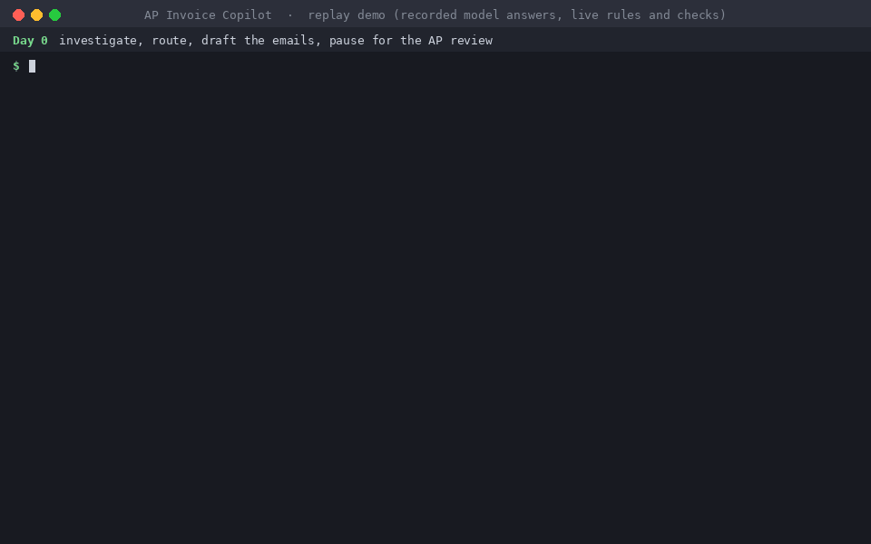
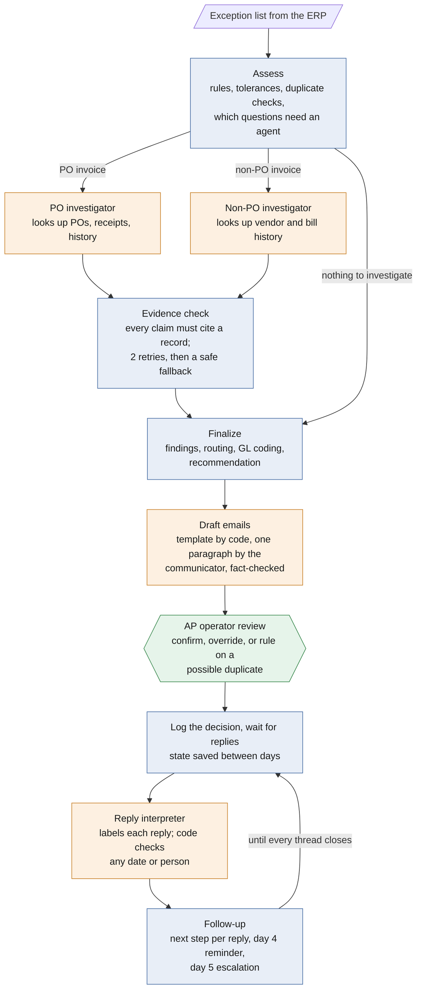

# AP Invoice Copilot

**AI agents that work the accounts payable exception queue, under the controls a finance team would require.**

[Leer en español »](README.es.md)

When an ERP holds an invoice (a price that doesn't match the PO, a quantity never received, a possible duplicate, a bill that needs approval), someone in AP has to investigate it, email the right person, and chase the reply. This project does that work end to end: it finds every issue on each held invoice, decides who must act, drafts the email, reads the replies, and follows up until the invoice clears.

The design rule: **AI investigates and writes. Code makes every financial decision. A person approves.**



*The demo replays the models' recorded answers, so it runs in seconds with no model installed. Every rule, check, and email is computed live.*

## At a glance

| | |
|---|---|
| **What it handles** | PO invoices (price and quantity variances, missing or invalid POs, duplicates, bad invoice data) and non-PO invoices (utilities, rent, taxes, subscriptions, professional services: approval rules, GL coding, category checks) |
| **How AI is controlled** | Every agent claim must cite a record it looked up. Every email paragraph is fact-checked. Rules, routing, GL coding, and deadlines are plain code. Every invoice pauses for the AP operator, and every decision is logged. |
| **How it was tested** | Like an audit: the expected answers for two batches of unseen cases were written, keyed blind, and committed to git *before* any model ran on them. Results are reported as they came out, misses included. |
| **Results on unseen cases** | Rules engine 58 of 58 invoices · PO investigator 25 of 26 · reply reading 33 of 36 · emails read correctly 81 of 82 · non-PO investigator right on 28 of 32 judgments, but below the bar on one scored column ([details](#results)) |
| **Stack** | Python 3.13 · LangGraph (stateful graph, human-in-the-loop pause, SQLite checkpoints) · Ollama with local models (qwen3:14b, llama3.1:8b) · Pydantic · pytest (92 tests) |
| **Try it** | [Four commands](#run-it), no model install needed. Or just read [every drafted email](output/phase10/emails_llama3.1-8b.md) and the [full evaluation report](docs/eval_report.md). |

## What it produces

One of the 23 emails from the demo, as the system drafted it (long lines wrapped here). A water bill came in 21.78% above the vendor's 12-month average, so code routed it to the cost center owner for approval and assigned the GL account. The first paragraph and the "From our review" explanation were written by AI agents and checked by code; everything else is a template filled in by code.

```text
To: Kevin Doyle <kevin.doyle@northgate.example>
Subject: Approval needed: invoice CWA-77324 from Clearwater Water Authority

Hello Kevin,

You are required to review invoice CWA-77324 from Clearwater Water Authority, which has a total
of 1046.30. The bill differs from the vendor's average bill by more than 10%, and approval is
needed.

Invoice CWA-77324 from Clearwater Water Authority, dated 2026-11-28, amount 1046.30.
Service month: 2026-11
Cost center: Facilities (CC-200)
GL account: 6100
Lines:
- line 1: Water and sewer service November 2026: amount 1046.30
Issues:
1. Approval needed
   - bill 15: average of the last 12 bills is 859.19; 1046.30 is +21.78%, over 10%
   - approver P-109: owner of CC-200
   - GL 6100 from category utilities
   From our review: This bill (1046.30) is 21.78% higher than the average of the last 12
   bills (859.19), exceeding the 10% threshold. Previous bills ranged from 827.95 to 889.35
   (e.g., CWA-77310: 862.40, CWA-77323: 843.60).
Action requested:
- Approve or reject this invoice.
Reply by: 2026-12-03

Accounts Payable
Northgate Distribution
ap@northgate.example
```

If Kevin doesn't answer, he gets a reminder on day 4 with his manager in copy, and on day 5 the request escalates to his manager.

## How it works



Blue is code, orange is an AI agent, green is the person.

**Code decides everything that moves money:** the checks, tolerances, duplicate rules, routing, GL coding, approvals, deadlines, reminders, and escalations. **Four agents do the fuzzy work**, and code checks each one:

| Agent | Its job | What code checks |
|---|---|---|
| PO investigator | Explains price and quantity variances, judges whether a duplicate candidate bills the same charge, finds the open PO an invoice belongs to | Every claim cites a record a lookup returned in this run, and every number is in the data it was shown. Two retries, then a safe fallback that sends the case to AP. |
| Non-PO investigator | Explains bill changes and rent differences, checks that every line fits the vendor's category, suggests a category for a vendor with none | The same evidence check. An unproven mismatch counts as a mismatch, so AP reviews it. |
| Reply interpreter | Reads each free-text reply: approved, rejected, correction coming, question, redirected, or unclear | A promised date must be in the reply's own words, and a named person must be on file. Otherwise the reply becomes unclear and goes to AP. |
| Communicator | Writes one plain-language paragraph per email | It sees only the facts its paragraph needs. A fact check rejects any number, ID, or name outside them, and a fixed sentence replaces a failed paragraph. |

**The AP rules it applies**

| Path | Rule | Who acts |
|---|---|---|
| PO invoices | Price or quantity variance beyond 2% or $100, whichever is less | Buyer |
| | Missing, closed, or wrong-vendor PO; missing or inconsistent invoice data | Vendor (the agent suggests the matching open PO) |
| | Exact duplicate: held. Possible duplicate (same PO, or same invoice number once normalized): every other email is held until AP rules | AP, then the vendor |
| Non-PO invoices | Utilities: approval if the bill moves more than 10% from the 12-month average, and for a new vendor's first 3 bills | Cost center owner |
| | Rent: any difference from the lease. Taxes and subscriptions: always | Cost center owner |
| | Professional services: the requester confirms the service, then approval (the manager approves if the requester owns the cost center) | Requester, then cost center owner |
| | No vendor category, no requester, or a line that doesn't fit the vendor's category | AP exception queue |

**Follow-up** runs on a business-day calendar: a reply is due in 3 days, a reminder goes on day 4 with the manager in copy, and day 5 escalates to the manager, who becomes the action owner. **GL coding** is done by code from the vendor's category; no agent ever picks an account. **Every decision**, edit, and reply interpretation is written to a decision log.

The data is a mock wholesale distributor (vendors, people, cost centers, POs, receipts, posted history) and an exception-list workbook modeled on an ERP export. No real email is sent, and nothing is paid.

## Results

Three data sets, each scored against expected answers fixed in advance. The bar is 80% on every scored column with 5 or more cases.

- **The 22-case eval** is the development set. The code and prompts were tuned on it, so it shows regression, not generalization.
- **Held-out batch A** (29 invoices, 18 replies) was keyed blind by a second AI agent, reviewed by the project owner, and committed before any model saw it.
- **Held-out batch B** (29 invoices, 18 replies) was keyed blind by the project owner, committed before any run, and run once as the confirmation run of the code as it ships, with no change before or after it.

| Agent job | 22-case eval (tuned) | Held-out A | Held-out B |
|---|---|---|---|
| PO investigator | 9 of 9 cases | 12 of 13 ✅ | **13 of 13** ✅ |
| Non-PO investigator | 9 of 12 cases | 9 of 16 ❌ | **8 of 16** ❌ |
| Reply interpreter | 18 of 18 replies | 16 of 18 ✅ | **17 of 18** ✅ |
| Communicator, first emails | 23 of 23 read correctly | 28 of 28 ✅ | **28 of 28** ✅ |
| Communicator, reminders and escalations | 7 of 7 | 12 of 13 ✅ | **13 of 13** ✅ |
| Rules engine (code only) | 22 of 22 invoices | 29 of 29 | **29 of 29** |

✅ bar met · ❌ bar not met

**Where it falls short, plainly:**
- **The non-PO investigator misses the bar on one column: which lookup it makes first** (5 of 10 on A, 4 of 10 on B). Its conclusions were right on 14 of 16 cases in each batch; the column scores the order of its lookups.
- **Its two real misses per batch are lines that don't fit the vendor's category**, such as a generator rental on an electric bill. A missed mismatch reaches AP as a release recommendation with no flag, so the AP review is the safety net.
- **The reply interpreter over-commits on partial approvals** ("pay the rent, not the furniture"), reading them as rejected instead of unclear.

The fixes for each are listed under [Not built](#not-built-next-version). They were deliberately not applied: batch B was the last unseen data, and a fix tuned on the cases that exposed it would no longer be an honest result.

The full report, with every case, every attempt, run times, and the hand scores, is [`docs/eval_report.md`](docs/eval_report.md). How the batches were built, keyed, and sealed is in [`evals/README.md`](evals/README.md).

<details>
<summary><b>Results by model, and why two models</b></summary>

The model for each agent was chosen on the 22-case runs:

| Agent job | llama3.1:8b | qwen3:14b |
|---|---|---|
| PO investigator | 8 of 9 (tuned on this model) | 9 of 9 |
| Non-PO investigator | 8 of 12 | 9 of 12 |
| Reply interpreter | 17 of 18 | 18 of 18 |

A first test of four local models on 20 cases (5 per job, pass mark 4 of 5 per job) gave llama3.1:8b 19 of 20, qwen3:4b 19, qwen3:8b 18, and qwen3:14b 20. llama3.1:8b is fast and writes the emails; qwen3:14b runs the three agents where judgment matters, at about 20 minutes per PO case on the development machine. Each agent's model is a setting, so a faster server or a stronger model swaps in without code changes.

</details>

## Run it

**The demo replays the saved model runs, so it needs Python 3.13 and nothing else:** no Ollama, no model download. In Windows PowerShell:

```powershell
git clone https://github.com/augustosander24/ap-invoice-copilot.git
cd ap-invoice-copilot
py -3.13 -m venv .venv
.venv\Scripts\python.exe -m pip install -r requirements.txt
copy .env.example .env
```

Then run the lifecycle:

| Step | Command | Look for |
|---|---|---|
| Day 0: investigate, route, draft, pause for review | `.venv\Scripts\python.exe scripts\run_emails.py` | `emails drafted: 23; paused for review: 22` |
| The AP review (scripted) | `.venv\Scripts\python.exe scripts\review.py --decisions data\input\review_decisions.csv --edits data\input\review_edits.csv` | `decision log: 22 entries` |
| Day 4: read replies, send reminders | `.venv\Scripts\python.exe scripts\run_day.py --day 4` | `sent today: 4 reminders, 0 escalations, 2 approvals after their confirmations` |
| Day 5: escalate | `.venv\Scripts\python.exe scripts\run_day.py --day 5` | `sent today: 0 reminders, 3 escalations` |

Each run writes its emails to a readable Markdown file beside its JSON (for example `output/phase10/emails_llama3.1-8b_replay.md`). Run `review.py` with no arguments to review each invoice yourself in the terminal. To start over, delete `output\phase10\checkpoints.sqlite` and `output\phase10\decision_log.jsonl`.

On macOS or Linux, use `python3.13 -m venv .venv`, `cp .env.example .env`, and `.venv/bin/python` with forward slashes.

<details>
<summary><b>Checks, tests, live models, and the held-out batches</b></summary>

**Checks and tests.** Each prints its result as the last line:

```powershell
.venv\Scripts\python.exe scripts\check_rules.py         # 22 of 22 cases match
.venv\Scripts\python.exe -m pytest tests -q             # 92 passed
```

**Run the models live.** Install [Ollama](https://ollama.com), then `ollama pull qwen3:14b` and `ollama pull llama3.1:8b`. Each script takes a flag to run its agent instead of replaying it:

```powershell
.venv\Scripts\python.exe scripts\run_emails.py --investigator live --communicator live
.venv\Scripts\python.exe scripts\run_day.py --day 4 --interpreter live --communicator live
```

The investigators and the interpreter can also be scored on their own against the expected answers: `scripts\run_po_agent.py`, `scripts\run_nonpo_agent.py`, and `scripts\run_replies.py`.

**Run a held-out batch.** Add `--set heldout_a` or `--set heldout_b` to any checker or runner, for example `.venv\Scripts\python.exe scripts\check_rules.py --set heldout_b`. `scripts\eval_report.py` rebuilds `docs/eval_report.md` from the saved runs.

</details>

<details>
<summary><b>Configuration: models, reasoning, output caps</b></summary>

Settings live in `.env` (copied from `.env.example`, which holds the reference setup):

| Setting | What it does | Reference value |
|---|---|---|
| `OLLAMA_HOST` | Address of the Ollama server | `http://localhost:11434` |
| `MODEL` | Model for any agent without its own setting | `llama3.1:8b` |
| `MODEL_PO_INVESTIGATOR`, `MODEL_NONPO_INVESTIGATOR`, `MODEL_REPLY_INTERPRETER`, `MODEL_COMMUNICATOR` | Model per agent; blank uses `MODEL` | `qwen3:14b` for the first three, blank for the communicator |
| `THINK_<AGENT>` | Reasoning per agent: `on` or `off` sends Ollama's think setting; blank sends nothing, so the model's default applies | `on` for the three qwen3:14b agents, blank for the communicator |
| `LANGGRAPH_STRICT_MSGPACK` | Makes LangGraph refuse state it can't store in a checkpoint | `true` |

The saved runs are found by model name, so the demo replays only with the reference models. A model with no reasoning mode, such as llama3.1:8b, must keep `THINK` blank: Ollama refuses `think` on it.

**Output caps.** Every model call has a cap on the tokens it may generate, thinking included: 4,096 for the investigators and the interpreter, 512 for the communicator (`MAX_TOKENS` in `ap_copilot/config.py`). A call cut at its cap takes its agent's safe path (a retry and then a fallback, an unclear reply, or the fixed sentence), and its `done_reason` is logged.

**Swapping a model.** Any model Ollama serves swaps in by setting, with no code change: set `MODEL_<AGENT>`, set `THINK_<AGENT>` to match the model, run that agent live, and score it with the same eval and held-out batches. An API model needs a client class beside `OllamaClient` (`ap_copilot/investigator.py`) with the same `chat()` method first.

</details>

## Design choices and where the rules come from

| Rule | Basis |
|---|---|
| Hold an invoice whose price or quantity differs from the PO beyond a tolerance; it can't be paid until the hold is cleared | Standard ERP behavior: SAP's [invoice verification with variances](https://learning.sap.com/courses/invoice-verification-in-sap-s-4hana/entering-invoices-with-variances-1) blocks the invoice for payment above a tolerance limit; Oracle Payables places a matching hold when the [invoice tolerances](https://docs.oracle.com/en/cloud/saas/financials/25d/faipp/invoice-tolerances.html) are exceeded, for example when the [quantity billed exceeds the quantity received or the price exceeds the PO price](https://docs.oracle.com/cd/A60725_05/html/comnls/us/ap/holdap03.htm) |
| Tolerance of 2% or $100, whichever is less, for price and quantity | **Design choice.** Both ERPs let each company set percentage and amount limits; these values are a common mid-market choice |
| Duplicate check on vendor and invoice number, with numbers normalized (case, punctuation, spaces, leading zeros) | The [SAP duplicate invoice check](https://help.sap.com/saphelp_afs64/helpdata/en/ce/4f3e39ea3aee02e10000000a114084/content.htm) compares the reference number and other attributes; Oracle Payables blocks the same number for the same supplier and notes that [variants such as a different case slip through](https://docs.oracle.com/cd/A60725_05/html/comnls/us/ap/duplinv.htm). Normalizing the number, and sending same-PO candidates to an agent, are **design choices** |
| PO invoices skip approval (the PO is the approval); non-PO invoices need approval by category | Common practice; the categories and their rules are **design choices** |
| Utility bills: 10% against a 12-month average, a new vendor's first 3 bills; rent against the lease; taxes, subscriptions, and services always approved; approver mapping; reply-by, reminder, and escalation days | **Design choices for this project**, not any ERP's standard |
| The input as an exception-list export | Modeled on one; not a specific SAP, Oracle, or NetSuite file layout |

<details>
<summary><b>The 22 test scenarios</b></summary>

| Case | Scenario | Expected | Result |
|---|---|---|---|
| EX-001 | PO price variance under $5,000 (2% limit applies) | price variance; hold; buyer query | pass |
| EX-002 | PO price variance over $5,000 ($100 cap applies); late buyer reply | price variance; hold; buyer query | pass |
| EX-003 | Invoice cites another vendor's PO; no matching open PO | invalid PO; vendor correction | pass |
| EX-004 | Partial receipt; small price difference within tolerance | quantity variance; buyer query | pass |
| EX-005 | No receipt posted plus a price variance; buyer redirects | price and quantity variance; buyer query | pass |
| EX-006 | Invoice cites a closed PO | invalid PO; open PO suggested to the vendor | pass |
| EX-007 | Inventory vendor invoice with no PO number | missing PO; open PO suggested | pass |
| EX-008 | Resent invoice with the leading zeros dropped | possible duplicate; AP rules | pass |
| EX-009 | Price variance plus a header total that doesn't match the lines | price variance and missing data | pass |
| EX-010 | Exact duplicate of a posted utility bill | exact duplicate; held, vendor notified | pass |
| EX-011 | Utility bill within 10% of the 12-month average | no issue; release | pass |
| EX-012 | Utility bill more than 10% above average; approver never replies | approval; reminder, then escalation | pass (first lookup differs) |
| EX-013 | New utility vendor's third bill, service period missing; vendor never replies | approval and missing data | pass (first lookup differs) |
| EX-014 | Rent above the lease (late fee added) | approval | pass |
| EX-015 | Rent equal to the lease | no issue; release | pass |
| EX-016 | Property tax bill | approval | pass |
| EX-017 | Subscription bill; approver asks a question | approval; question to AP | pass |
| EX-018 | Subscription vendor also bills hardware; unclear reply | approval and category mismatch | pass |
| EX-019 | Services invoice where the requester owns the cost center | confirmation, then the manager approves | pass |
| EX-020 | Services invoice: confirmation first, then approval | confirmation, then approval | pass |
| EX-021 | Services invoice with no requester | AP exception queue | pass |
| EX-022 | Vendor with no category | AP sets the category; agent suggests one | pass (first lookup differs) |

"First lookup differs" means the agent's answer was right but it started with a different lookup than the one expected. Every case's expected result, in full, is in [`evals/expected_outcomes.csv`](evals/expected_outcomes.csv).

</details>

## Limits

The three that matter most are under [Results](#results). The full list:

<details>
<summary><b>All 23 limits</b></summary>

**What the agents can get wrong**
1. A cited claim can still be wrong. The evidence check proves a claim points to records the tools returned, not that the reasoning is right (llama3.1:8b's EX-018 and EX-013 answers passed it).
2. A reason can state an inference the check can't verify (EX-008: "identical line items", inferred from the PO's lines).
3. A "none" PO match passes when it cites the open-PO search, even if an open PO matches (seen twice during development).
4. A missed category mismatch puts a release recommendation in AP's review packet with no flag, and code then codes the invoice to the vendor's category account. Seen on both held-out batches: EX-118 on A; EX-218 (a generator rental on an electric bill, released when the operator confirmed) and EX-221 (add-on storage on a subscription) on B.
5. The reply interpreter over-commits on partial or ambiguous replies: a partial approval should be unclear, and the model reads it as rejected (M-25 and M-32 on A, M-62 on B). The eval's M-16 is labeled against the partial-approval rule M-32 follows.
6. The reply label is a judgment code can't verify: the check covers only a promised date and a named person. The interpreter also fills date and person fields it doesn't need; code reads them only for the labels that use them.

**What the checks can't see**

7. The fact check proves figures and names in a paragraph exist in its facts, not that a sentence is right. An unknown name as a sentence's first word isn't caught.
8. A boilerplate reason meets the five-word rule.
9. The evidence check can reject a correct answer whose evidence ID is only in its reason text, three times, and then fall back to AP review (EX-112 on A).
10. One call was cut at the output cap on each held-out batch (EX-111 on A, EX-211 on B); both cases still ended right. The cap exists because, without one, a reasoning model run locally generated 17,404 tokens over 2 hours.

**What the demo doesn't do**

11. Nothing is sent: "sent" means the demo outbox. "Ready to release" is a recommendation; nothing is paid.
12. A redirect, a question, or an unclear reply goes to AP; nothing forwards or answers it. A promised correction isn't chased after its date.
13. The business-day calendar has no holidays.
14. Day 0 is two commands: the drafts, then the review.
15. An override can release an exact duplicate on the PO path (blocking it is not built). An override never releases a non-PO invoice, and a non-PO duplicate candidate always goes to AP, by design.
16. A non-PO invoice is coded to one GL account by its vendor's category; there is no line-level coding or capitalization check.
17. An API model needs a client class beside `OllamaClient`.

**What the evaluation can and can't show**

18. The first-lookup column scores an order preference on multi-task cases; on the category cases, the vendor lookup it expects adds nothing. Non-PO first lookup: 1 of 4 on the eval, 5 of 10 on A, 4 of 10 on B, below the bar. On every judgment column the non-PO investigator was right on 14 of 16 cases of each held-out batch.
19. The held-out batches are synthetic, written by the same process from the eval's templates, and small (13 PO, 16 non-PO, 18 replies each). They show generalization to new cases of the same kinds, not to real invoices.
20. Batch A was keyed blind by a second AI agent and reviewed by the owner. Batch B was keyed blind by the owner, who agreed with the expected answers on 35 of 39 items before the differences were settled; three of the 39 were known in advance.
21. The hand scores (email paragraphs and explanations) were drafted by an AI assistant and confirmed by the project owner.
22. Each result is one run at temperature 0 on one machine. A live rerun may word things differently, which is why the demo replays the saved runs.
23. Batch B used up the held-out data: no model or design change can be tested on unseen cases now.

</details>

## Not built (next version)

- **A code backstop for category mismatches:** always flag lines like rentals, equipment, hardware, furniture, and add-ons for AP review, whatever the agent says.
- **Clearer reply labels** so a partial approval is unclear, and **scoring the first lookup by the records found**, not their order. Each needs a new unseen batch to test honestly.
- **Richer GL coding:** line-level coding from a rules table, a capitalization check for asset-like lines, cost center splits.
- **A friendlier interface:** a cleaner command line (color, a progress bar, one summary line per invoice, plain-language status names) and, later, a review screen in place of the terminal.
- **Production plumbing:** a real ERP and mailbox connection and a faster model server.
- Blocking an override from releasing an exact duplicate; forwarding a redirect; chasing a promised correction.
- Out of scope for v1: drop-ship, sales rep approvals, an agent that answers questions, multi-step delegation of authority, credit memos, bank-detail changes, multi-currency, emergency repairs, small ad hoc purchases.

## Repo layout

| Folder | What's in it |
|---|---|
| `ap_copilot/` | The workflow: `rules.py` (every check), `routing.py`, `tools.py` (the read-only lookups), `evidence.py` (the evidence check), `investigator.py` and `nonpo_investigator.py`, `emails.py` (templates and the fact check), `reply_interpreter.py`, `followup.py`, `graph.py` (the LangGraph graph), `review.py`, `replay.py`, `config.py` |
| `scripts/` | The demo commands, the agent runners, the four checkers, `eval_report.py`, `build_heldout.py` |
| `data/` | The mock company (`reference/`), the exception list and inbox (`input/`), the held-out batches, and their case tables (`heldout_tables/`). Data dictionaries: [`data/reference/README.md`](data/reference/README.md), [`data/input/README.md`](data/input/README.md) |
| `evals/` | Expected outcomes and threads for each set; [`evals/README.md`](evals/README.md) |
| `docs/` | [`eval_report.md`](docs/eval_report.md), the hand scores, the earlier runs' history, the demo GIF |
| `tests/` | 92 unit tests |
| `output/` | The saved runs (below); your own runs land here too and stay out of git |

**Saved runs.** `output/` is gitignored, but the runs the replays and the report read are tracked:

| Files | Read by |
|---|---|
| `output/phase6/po_run_qwen3-14b.json`, `output/phase8/nonpo_run_qwen3-14b.json` | Day 0's investigator replay (eval) |
| `output/phase9/replies_qwen3-14b.json` | The day runs' interpreter replay (eval) |
| `output/phase10/emails_llama3.1-8b.json`, `day_2026-12-04.json`, `day_2026-12-07.json` (with `.md` copies) | The communicator replays and the report |
| `output/phase10/run1/` | The report (the communicator's run before the last design round) |
| `output/phase10/heldout_a/`, `output/phase10/heldout_b/` | The report: each batch's investigator, interpreter, communicator, and day runs |

The folder names follow the build phase each run comes from. Python 3.13, LangGraph 1.2, Ollama; the exact versions are pinned in `requirements.txt`.

## About

Built by Augusto Sander, an accounts payable professional with 18 years of full-cycle U.S. AP experience. The AP rules, the control design, the answer keys, and every approval in this project are mine; the code was written with an AI coding assistant, one reviewed phase at a time.
